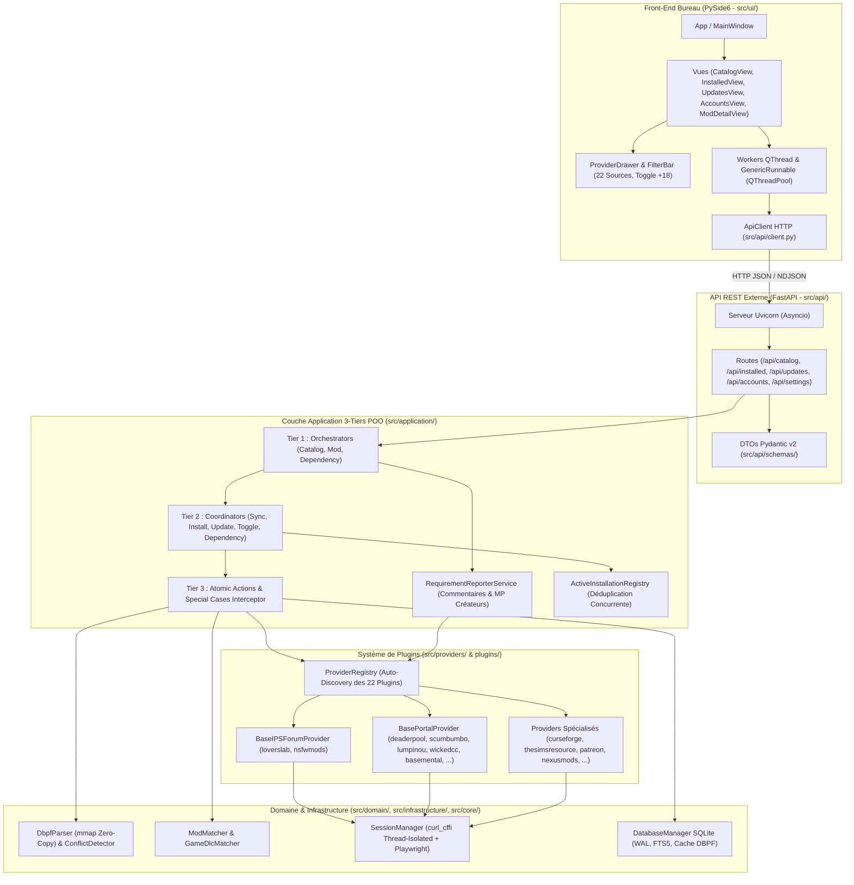
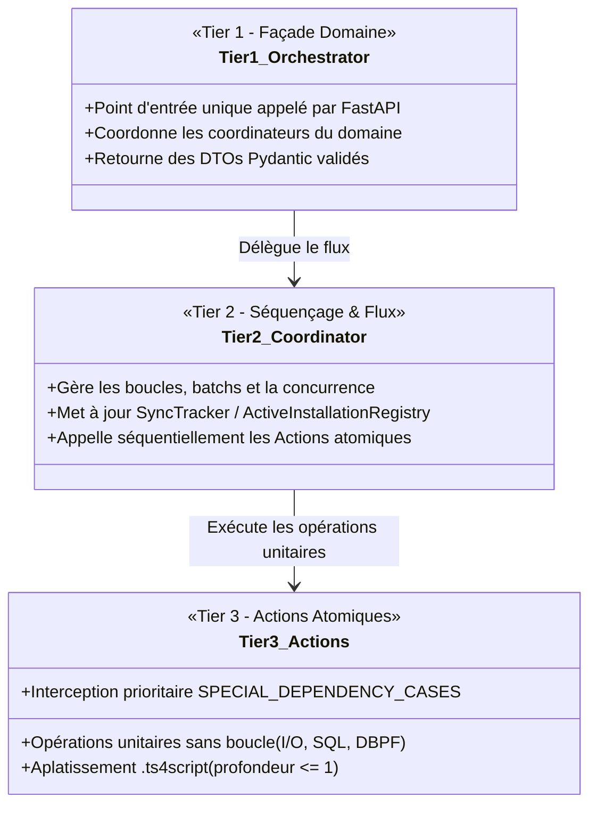

# 🏛️ Architecture Logicielle Unifiée : SIMS 4 Mods Manager

Ce document constitue la référence architecturale unique de **SIMS 4 Mods Manager** (mutualisant la vue d'ensemble, l'architecture hexagonale / Clean Architecture, le découpage POO 3-Tiers, la gestion de la concurrence, les optimisations SQLite/FTS5 et les moteurs critiques de résolution de dépendances et d'analyse binaire DBPF).

---

## 1. Principes Fondamentaux (Clean Architecture & Étanchéité)

L'application repose sur cinq piliers :

- **1. Séparation Stricte en 5 Couches** :
  - **Domaine (`src/domain/`)** : Entités métier pures, interfaces de repositories (`ICatalogRepository`, `IInstalledModRepository`, `IAccountRepository`), analyseur binaire DBPF (`DbpfParser`) et détecteur de conflits (`ConflictDetector`).
  - **Infrastructure (`src/infrastructure/`)** : Implémentations SQLAlchemy 2.0 / SQLite (mode `WAL`, index `FTS5`), extracteurs d'archives sécurisés (`ZIP`, `7Z`, `RAR`) et chiffrement `AES-256-GCM`.
  - **Application (`src/application/`)** : Cas d'usage métier structurés selon le modèle **POO 3-Tiers** (`Orchestrator` → `Coordinator` → `Actions`).
  - **Providers & Plugins (`src/providers/`, `plugins/`)** : Architecture de plugins auto-découverts (`@register_provider`) reposant sur deux socles mutualisés (`BaseIPSForumProvider` et `BasePortalProvider`).
  - **Présentation (`src/api/` & `src/ui/`)** : Serveur REST FastAPI asynchrone et interface graphique PySide6 découplée (communiquant exclusivement via `ApiClient`).
- **2. Étanchéité Front → Back** :
  Aucun composant de `src/ui/` n'importe `DatabaseManager` ni les modèles SQLAlchemy. Toute lecture ou mutation passe par `src/api/client.py`.

- **3. Priorité Absolue aux Sites Officiels des Frameworks (`SPECIAL_DEPENDENCY_CASES`)** :
  Toute dépendance vers **Deaderpool (`MCCC`)**, **Scumbumbo (`XML Injector`)**, **Lumpinou (`RPO`, `Mood Pack`, `Toolbox`)**, **Wicked.cc (`WickedWhims`, `WonderfulWhims`)**, **Basemental (`Drugs`, `Gangs`, `Venue List`)** ou **Sims 4 Studio (`Andrew's Pose Player`)** est interceptée en priorité absolue en `O(1)` et résolue sur son site officiel public.

- **4. Déduplication Inter-Plateformes & Concurrence (`ActiveInstallationRegistry`)** :
  `ModMatcher.canonical_fingerprint` normalise les titres de mods indépendamment de la plateforme et du suffixe de version pour éviter toute réinstallation d'un mod déjà présent. `ActiveInstallationRegistry` empêche deux installations parallèles de télécharger deux fois une même dépendance partagée.
- **5. Arrêt Propre (`ShutdownManager`)** :
  Tous les pools de threads, sessions HTTP `curl_cffi` et workers de scraping coopèrent avec `ShutdownManager.is_shutting_down()` pour une fermeture instantanée sans thread orphelin.

---

## 2. Diagramme Global des Couches

---

## 3. Modèle d'Architecture 3-Tiers POO (`src/application/`)

Chaque domaine applicatif est divisé en 3 niveaux stricts :

### 3.1 Domaine Catalogue (`src/application/catalog/`)

- **`CatalogOrchestrator`** : Façade exposant la synchronisation multi-plateformes, la recherche FTS5 et l'inspection détaillée des mods.
- **`CatalogSyncCoordinator`** : Parcourt en parallèle les sous-catégories des 22 providers, applique un backoff exponentiel en cas de limitation réseau et met à jour `SyncTracker` en temps réel.
- **`CatalogSyncActions`** : Persistance atomique par lot (`UPSERT` SQLite avec déduplication intra-lot) et normalisation des métadonnées.

### 3.2 Domaine Mods (`src/application/mods/`)

- **`ModOrchestrator`** : Façade pour l'installation en cascade, la mise à jour avec rollback, le toggle `.disabled` et le diagnostic de conflits DBPF.
- **`ModInstallCoordinator` & `ModInstallActions`** :
  - Utilise `ActiveInstallationRegistry` pour éviter tout téléchargement concurrent en doublon d'une dépendance partagée.
  - Applique la règle d'or du moteur Les Sims 4 : tout fichier `.ts4script` extrait à plus d'un niveau de profondeur est automatiquement remonté dans `Mods/<NomDuMod>/script.ts4script`.
  - Valide l'en-tête binaire `DBPF` des fichiers `.package` et rejette les pages HTML d'erreur ou de connexion.
- **`ModUpdateCoordinator` & `ModUpdateActions`** : Crée une sauvegarde ZIP automatique dans `.sims4_mod_manager/backups/` avant toute mise à jour et restaure automatiquement l'archive en cas d'échec.
- **`ModToggleCoordinator` & `ModToggleActions`** : Renomme de façon réversible `.package` ↔ `.package.disabled` et `.ts4script` ↔ `.ts4script.disabled`.

### 3.3 Domaine Dépendances (`src/application/dependencies/`)

- **`DependencyOrchestrator`, `DependencyCoordinator` & `DependencyActions`** :
  - **Étape 1 (Interception Officielle Prioritaire)** : Vérifie systématiquement `find_special_dependency_case(title, url, remote_id)` en tout premier lieu. Même si un mod pointe vers un lien tiers (ex. `loverslab.com/files/file/3169-wickedwhims/` ou CurseForge), la dépendance est redirigée vers son site officiel (`wickedcc`, `deaderpool`, `scumbumbo`, `lumpinou`, `basemental`, `sims4studio`).
  - **Étape 2 (Déduplication Inter-Plateformes)** : Vérifie si le mod est déjà installé localement via `(source, remote_id)`, `SPECIAL_DEPENDENCY_REMOTE_IDS` ou `ModMatcher.canonical_fingerprint`.
  - **Étape 3 (Classification 4 Statuts & Filtrage Bruit)** : Classe chaque élément en `INSTALLED`, `DETECTED_NOT_INSTALLED`, `NOT_DETECTED_SCANNING`, `NOT_DETECTED_FINISHED` ou `COMMENT_NOISE` (avec surcharge manuelle `MOD` ↔ `COMMENT`).
- **`RequirementReporterService`** : Gère la vérification anti-doublon en direct, la génération du message standardisé en anglais, la publication de commentaire ou MP et la suppression de commentaire sur les plateformes supportant l'authentification (`loverslab`, `nsfwmods`, `curseforge`, `thesimsresource`, `modthesims`, `simsfinds`, `nexusmods`, `mmccworld`, `sims4studio`, `f95zone`, `gamebanana`, `itchio`, `synthira`).

---

## 4. Analyse Binaire DBPF (`mmap` Zero-Copy) & Conflits

- **`DbpfParser` (`src/infrastructure/filesystem/dbpf_parser.py`)** :
  - Utilise `mmap.mmap(..., access=mmap.ACCESS_READ)` pour inspecter les fichiers `.package` sans copier l'intégralité du fichier en RAM.
  - Vérifie la signature `DBPF` (octets `0..4`), lit le nombre d'entrées d'index et la position de la table d'index (octets `36..68`), puis extrait en une passe vectorisée les triplets `(Type, Group, Instance)` (`TGI`).
- **Cache Incrémental SQLite (`dbpf_package_cache`)** :
  - Stocke les ressources TGI indexées par `(file_path, mtime, file_size)` pour éviter de re-parser les fichiers `.package` inchangés lors des diagnostics successifs.
  - Utilise l'instruction native SQLite `INSERT ... ON CONFLICT(file_path) DO UPDATE` par lots de 250, découpe les requêtes `IN` par lots de 400 clés et purge automatiquement les entrées de cache orphelines lorsque des fichiers `.package` sont supprimés.
- **`ConflictDetectorService` (`src/application/mods/conflict_detector_service.py`)** :
  - Identifie et distingue les collisions critiques de **Tuning / SimData** des simples remplacements de traductions **STBL** (`0x220557DA`).

---

## 5. Optimisations Base de Données (SQLite WAL, FTS5 & SQLAlchemy 2.0)

- **Empreinte Canonique Indexée (`title_fingerprint` — Migration `005`)** :
  Persistée et indexée sur `CatalogMod` (`idx_catalog_title_fp`) et `InstalledMod` (`idx_installed_title_fp`), maintenue automatiquement via les événements SQLAlchemy `before_insert` / `before_update`. Permet la résolution inter-plateformes (`ModMatcher`) et l'enrichissement automatique des mods installés manuellement (`InstalledModsService`) en **`O(log N)`**.
- **Classification Pré-Calculée (`mod_type` — Migration `006`)** :
  Colonne `mod_type` auto-calculée via `ModTypeClassifier.classify_mod()` et couverte par l'index composite `idx_catalog_mod_type_updated (mod_type, updated_date, id)`, remplaçant les 25+ clauses `ILIKE '%keyword%'` par une recherche B-Tree en **`O(log N)`**.
- **Alignement FTS5 (`rowid = catalog_mods.id`) & Triggers Sélectifs** :
  La table virtuelle `catalog_mods_fts` aligne son `rowid` interne sur `catalog_mods.id` et ne déclenche sa mise à jour que sur `AFTER UPDATE OF title, author, tags, description`.
- **Tuning SQLite WAL & Pragmas** :
  `PRAGMA journal_mode=WAL`, `PRAGMA foreign_keys=ON`, `PRAGMA wal_autocheckpoint=1000`, `PRAGMA journal_size_limit=67108864` (64 Mo), `PRAGMA mmap_size=268435456` (256 Mo) et `PRAGMA optimize`.

---

## 6. Concurrence, Sessions HTTP & Sécurité

- **`ThreadPoolManager` (`src/core/thread_pool.py`)** : Pools bornés séparés pour les opérations I/O réseau et les calculs CPU (extraction d'archives, hachage).
- **Isolation Thread-Safe `curl_cffi` (`SessionManager`)** : Les sessions HTTP d'impersonation Chrome sont isolées par clé `(provider_name, thread_id)` pour garantir le réemploi Keep-Alive sans corruption de descripteurs libcurl entre threads.
- **Chiffrement `AES-256-GCM`** : Les cookies de session et clés API stockés dans SQLite (`AccountSession`) sont chiffrés au repos via `CredentialCipher`.
- **Défense Anti-Zip-Bomb & SSRF** : Contrôle strict des ratios de compression, des quotas d'octets extraits, blocage du *Path Traversal* (`..`) et validation des schémas/hôtes d'URLs.
