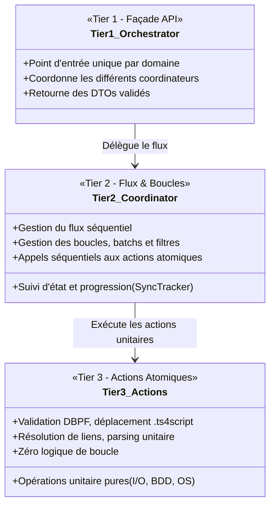

# Architecture du Projet : SIMS 4 Mods Manager

Ce document décrit en détail l'architecture logicielle de l'application **SIMS 4 Mods Manager**, structurée selon les principes de la **Clean Architecture**, du découpage par responsabilité unique (**SRP**) et d'un **modèle Orienté Objet 3-Tiers**.

---

## 🏛️ Vue d'Ensemble des Couches

L'application est conçue pour garantir un découplage total entre l'interface utilisateur, l'orchestration des données, les flux métier et la persistance :

```mermaid
graph TD
    UI[Interface Graphique PySide6<br/>src/ui/views, src/ui/components] -->|Requêtes HTTP Typées| ApiClient[ApiClient HTTP<br/>src/api/client.py]
    UIWorkers[Workers Asynchrones QThread<br/>src/ui/workers/] -->|Appels Background| ApiClient
    ApiClient -->|REST JSON / NDJSON| APILayer[API REST FastAPI<br/>src/api/routes/]
    APILayer -->|Validation & DTOs| Schemas[Schémas Pydantic<br/>src/api/schemas/]
    APILayer -->|Appel Façade Tier 1| Orchestrators[Application - Orchestrateurs (Tier 1)<br/>src/application/*/*_orchestrator.py]
    Orchestrators -->|Gestion Boucles & Flux Tier 2| Coordinators[Application - Coordinateurs (Tier 2)<br/>src/application/*/*_coordinator.py]
    Coordinators -->|Actions Atomiques Tier 3| Actions[Application - Actions & Normalizers (Tier 3)<br/>src/application/*/*_actions.py]
    Actions -->|Persistance & CRUD| Database[Couche Données<br/>src/database/]
    Actions -->|Web Scraping & I/O| Providers[Fournisseurs Externes<br/>src/providers/]
    Providers -->|Sessions & Anti-Bot| Core[Core & Utilitaires<br/>src/core/, src/utils/]
```

---

## 🧩 Modèle d'Architecture 3-Tiers POO (`src/application/`)

Pour garantir une lisibilité optimale, une testabilité unitaire maximale et une évolutivité sans friction, chaque domaine de la couche applicative est découpé en trois niveaux de responsabilité distincts :



### 1. Domaine Catalogue (`src/application/catalog/`)
- **Tier 1 - `CatalogOrchestrator`** (`catalog_orchestrator.py`) : Façade appelée par les routeurs FastAPI (`/api/catalog`). Expose `sync_catalog()`, `get_sync_status()`, `check_dependencies()`.
- **Tier 2 - `CatalogSyncCoordinator`** (`catalog_sync_coordinator.py`) : Gère le parcours paginé des catégories LoversLab/Patreon, le suivi de progression `SyncTracker` et la concurrence des workers.
- **Tier 3 - `CatalogSyncActions`** (`catalog_sync_actions.py`) : Exécute l'enregistrement atomique d'un mod en BDD, la conversion des dates et l'extraction unitaire.

### 2. Domaine Mods (`src/application/mods/`)
- **Tier 1 - `ModOrchestrator`** (`mod_orchestrator.py`) : Façade pour l'installation, la mise à jour, l'activation/désactivation et le scan des mods installés.
- **Tier 2 - Coordinateurs de flux** :
  - `ModInstallCoordinator` (`mod_install_coordinator.py`) : Enchaîne la cascade des dépendances puis l'installation du mod principal.
  - `ModUpdateCoordinator` (`mod_update_coordinator.py`) : Gère la boucle de mise à jour par lot ou unitaire avec archivage rollback préalable.
  - `ModToggleCoordinator` (`mod_toggle_coordinator.py`) : Orchestre l'activation / désactivation réversible.
- **Tier 3 - Actions atomiques** :
  - `ModInstallActions` (`mod_install_actions.py`) : Téléchargement unitaire, extraction d'archive, application de la règle `.ts4script` (profondeur max 1) et validation binaire DBPF.
  - `ModUpdateActions` (`mod_update_actions.py`) : Sauvegarde ZIP de secours et restauration automatique en cas d'erreur.
  - `ModToggleActions` (`mod_toggle_actions.py`) : Renommage atomique des extensions `.disabled` sur le système de fichiers.

### 3. Domaine Dépendances (`src/application/dependencies/`)
- **Tier 1 - `DependencyOrchestrator`** (`dependency_orchestrator.py`) : Façade d'analyse de dépendances et de signalement de prérequis manquants.
- **Tier 2 - Coordinateurs de flux** :
  - `DependencyResolutionCoordinator` (`dependency_resolution_coordinator.py`) : Parcours de la liste des prérequis, classification parmi les 4 statuts et requêtes BDD en masse.
  - `RequirementReportCoordinator` (`requirement_report_coordinator.py`) : Flux de génération de rapports d'interpellation pour forums LoversLab.
- **Tier 3 - Actions atomiques** :
  - `DependencyResolutionActions` (`dependency_resolution_actions.py`) : Détection unitaire d'un mod sur disque ou en base, matching de titres.
  - `RequirementReportActions` (`requirement_report_actions.py`) : Formatage BBCode/Markdown du rapport.
  - `DependencyNormalizer` (`dependency_normalizer.py`) : Normalisation de texte, détection de bruit et exclusion de phrases narratives.

### 4. Domaine Jeu & Système (`src/application/game/`)
- `GameService` : Façade unifiée pour la détection du jeu et de son statut.
- `GameDetector` : Détection du dossier Mods utilisateur (Windows Documents, OneDrive, multilingue) et génération du `Resource.cfg`.
- `GameLauncher` : Détection du binaire de jeu (`TS4_x64.exe`) via le registre Windows / Steam et lancement supervisé.

---

## 📂 Arborescence Détaillée du Projet

```text
SIMS4-Mods-Manager/
├── pyproject.toml                     # Configuration projet, dépendances uv et outils de build
├── run.py                             # Point d'entrée unique (PySide6 GUI par défaut, ou --server FastAPI)
├── README.md                          # Guide d'accueil, synthèse et démarrage express
├── INSTRUCTIONS.md                    # Guide des règles métier Sims 4 et retours d'expérience
├── mkdocs.yml                         # Configuration de la documentation Material for MkDocs
├── documentation/                     # Documentation technique exhaustive
│   ├── index.md                       # Portail d'accueil de la documentation
│   ├── architecture.md                # (Ce document) Principes d'architecture & découpage 3-tiers
│   ├── modules_and_classes.md         # Diagrammes de liaisons, classes et séquences Mermaid
│   ├── services_and_providers.md      # Détails des services applicatifs et connecteurs
│   ├── api_reference.md               # Spécification complète des endpoints REST & DTOs
│   ├── proposals_and_roadmap.md       # Propositions d'optimisations de performance & feuille de route
│   └── dependency_classification_and_noise.md # Moteur de prérequis et règles de filtrage
├── src/
│   ├── i18n.py                        # Singleton I18nManager & fonction de traduction tr()
│   ├── locales/                       # Catalogues de traduction JSON (fr.json, en.json, es.json)
│   ├── api/                           # Présentation API REST (FastAPI)
│   │   ├── app.py                     # Initialisation FastAPI, middlewares CORS, cycle de vie
│   │   ├── client.py                  # Client HTTP (ApiClient) consommé par l'UI PySide6
│   │   ├── deps.py                    # Injection de dépendances (get_db)
│   │   ├── server.py                  # Gestionnaire Uvicorn (thread daemon ou serveur autonome)
│   │   ├── schemas/                   # DTOs Pydantic v2 validés par domaine
│   │   └── routes/                    # Contrôleurs HTTP découplés
│   ├── application/                   # Couche Applicative Métier (Modèle 3-Tiers POO)
│   │   ├── catalog/                   # Tier 1, 2, 3 : Catalogue & Synchronisation
│   │   ├── mods/                      # Tier 1, 2, 3 : Installation, Mises à jour, Toggle
│   │   ├── dependencies/              # Tier 1, 2, 3 : Résolution de prérequis & Rapports
│   │   └── game/                      # Détection Sims 4, lanceur et Resource.cfg
│   ├── database/                      # Couche Persistance (SQLAlchemy + SQLite)
│   │   ├── connection.py              # Engine SQLite, session factory, création du schéma
│   │   ├── models.py                  # Entités ORM (CatalogMod, InstalledMod, AccountSession, AppSettings)
│   │   └── manager.py                 # DatabaseManager singleton, opérations CRUD, maintenance
│   ├── providers/                     # Connecteurs de plateformes externes
│   │   ├── base.py                    # Classe abstraite BaseSourceProvider
│   │   ├── loverslab/                 # Scraper, parser BeautifulSoup et downloader LoversLab
│   │   └── patreon/                   # Provider Patreon avec support des abonnements payants
│   ├── core/                          # Fondations techniques transverses (Config, Exceptions, DTOs, Shutdown)
│   ├── ui/                            # Interface Graphique PySide6 (Vues, Composants réactifs, Workers QThread)
│   └── utils/                         # Utilitaires (Archives, Cache LRU, FileUtils, ModMatcher, Logger)
└── tests/                             # Suite de tests automatisée unifiée (229 tests - 100% vert)
    ├── conftest.py                    # Fixtures pytest partagées (Client API, SQLite mémoire, Mock Qt)
    ├── unit/                          # Tests Unitaires par module
    │   ├── api/                       # Validation des routes REST et schémas
    │   ├── application/               # Tests unitaires des Orchestrators, Coordinators et Actions
    │   ├── core/                      # Tests des fondations et gestionnaires
    │   ├── database/                  # Tests CRUD et intégrité relationnelle
    │   ├── providers/                 # Tests des parsers HTML purs et downloaders
    │   ├── ui/                        # Tests des composants PySide6 et dialogs
    │   └── utils/                     # Tests du cache, matcher et gestion des versions
    └── e2e/                           # Tests de bout en bout (Simulations utilisateur)
        ├── test_mocked_flow_e2e.py    # Flux complet simulé avec mocks déterministes (FastAPI + BDD + FS)
        └── test_live_simulation_e2e.py # Scénario de bout en bout marqué live (@pytest.mark.live)
```

---

## 🛡️ Règles Architecturales Strictes

1. **Aucun Import Direct BDD depuis l'UI** : L'interface graphique PySide6 n'importe jamais `DatabaseManager` ni `src.database.models`. Elle consomme exclusivement les données via `ApiClient` (`src.api.client.py`).
2. **Pas de Logique Métier dans les Routeurs** : Les fichiers `src/api/routes/*_router.py` sont de simples contrôleurs HTTP. Ils reçoivent les requêtes, valident les schémas Pydantic, appellent l'orchestrateur correspondant dans `src/application/` et retournent les réponses formatées.
3. **Immutabilité des Schémas (DTOs)** : Les schémas d'entrée/sortie sont isolés dans `src/api/schemas/` et ne dépendent jamais des modèles ORM SQLAlchemy.
4. **Découplage 3-Tiers Strict** : Les orchestrateurs (Tier 1) ne réalisent aucune boucle ni action de bas niveau. Les coordinateurs (Tier 2) gèrent le séquençage et délèguent chaque action atomique aux classes Actions (Tier 3).
5. **Gestion de l'Arrêt Propre (Graceful Shutdown)** : Tous les processus asynchrones vérifient périodiquement `ShutdownManager.is_shutting_down()` pour éviter toute fuite mémoire ou plantage de threads orphelins.
