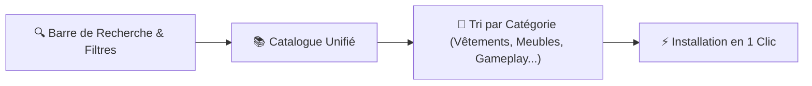

# ✨ Guide Complet des Fonctionnalités — SIMS 4 Mods Manager

Ce guide présente en détail comment **SIMS 4 Mods Manager** vous aide au quotidien à trouver de nouveaux contenus, installer vos mods sans erreur et garder votre jeu **Les Sims 4** fluide et stable.

---

## 1. 🌐 Catalogue Tout-en-Un & Recherche Instantanée

L'onglet **Catalogue** réunit au même endroit tous vos sites de mods et de Custom Content (CC) :

- **Sites Officiels de Mods Socles** : Accès direct aux grands mods utilitaires et frameworks indispensables.
- **Catalogues Communautaires & Créateurs** : Coiffures, vêtements, maquillage, meubles, maisons, mods de gameplay, carrières et traits de caractère.
- **Portails Adultes (`+18`)** : Masqués par défaut pour une utilisation tout public, et activables à la demande dans les **Paramètres**.

### Ce que vous pouvez faire dans le Catalogue :

- **Recherche Instantanée** : Tapez le nom d'un mod, d'un créateur ou un mot-clé pour afficher immédiatement les résultats correspondants parmi des milliers de créations.
- **Tri par Catégorie de Contenu** : Filtrez en un clic par *Animations & Poses*, *Vêtements & Tenues*, *Coiffures*, *Peaux & Presets*, *Accessoires & Maquillage*, *Gameplay & Scripts*, *Objets & Terrains* ou *Traductions*.
- **Filtres Pratiques** : Affichez uniquement les mods déjà installés, ceux qui ont une mise à jour disponible, ou les sites accessibles sans aucun compte requis.
- **Suivi en Temps Réel** : Un volet latéral vous permet de suivre l'actualisation de chaque site et de mettre en pause ou relancer une plateforme quand vous le souhaitez.

---

## 2. 🛡️ Téléchargement Automatique des Prérequis depuis les Sites Officiels

Dans la communauté **Les Sims 4**, de nombreux mods ont besoin d'un mod socle ou d'un injecteur pour fonctionner en jeu. Souvent, la page du mod renvoie vers un lien secondaire ou un forum demandant un compte.

**SIMS 4 Mods Manager** reconnaît automatiquement ces prérequis et **va toujours les chercher directement sur le site officiel de leur créateur**, gratuitement et sans vous demander de compte :

| Type de Prérequis | Bénéfice pour votre Jeu | Accès & Téléchargement |
| :--- | :--- | :--- |
| **Grands Mods de Contrôle & Gameplay** | Télécharge toujours la dernière version officielle compatible avec votre patch EA | ✅ **100% Public (Sans compte)** |
| **Injecteurs de Scripts & Utilitaires** | Évite les menus invisibles en jeu lorsqu'un mod dépend d'un injecteur commun | ✅ **100% Public (Sans compte)** |
| **Bibliothèques d'Animations & Poses** | Installe automatiquement le lecteur d'animations requis par vos packs | ✅ **100% Public (Sans compte)** |
| **Packs d'Objets & Lieux Communautaires** | Récupère les listes de terrains et ressources partagées directement à la source | ✅ **100% Public (Sans compte)** |

---

## 3. 🧩 Fin des Doublons & Tri Automatique des Notes d'Auteurs

Lorsque vous installez un ou plusieurs mods en même temps :

- **1. Aucun Mod Installé en Double** :
  Si un prérequis est déjà présent dans votre dossier `Mods` (même s'il a été téléchargé depuis un autre site), l'application le reconnaît immédiatement comme **Déjà installé** et ne le télécharge pas une seconde fois.

- **2. Téléchargement Groupé Intelligent** :
  Si vous lancez l'installation simultanée de plusieurs mods qui ont tous besoin du même prérequis, celui-ci n'est téléchargé et installé **qu'une seule fois**.

- **3. Séparation entre Vrais Prérequis et Simples Consignes** :
  Les auteurs écrivent souvent des rappels dans la liste des prérequis (*« Activer les mods de script dans les options du jeu »*, *« Ne pas repartager »*). L'application écarte automatiquement ces notes pour ne télécharger que les vrais mods, tout en vous permettant de basculer manuellement un élément en un clic.

---

## 4. 📢 Contacter les Créateurs en 1 Clic (Commentaires & Messages)

Lorsqu'une fiche de mod mentionne un prérequis introuvable ou un lien cassé :

- **Invitation Guidée à se Connecter** : L'application vérifie si vous êtes connecté au site concerné et vous propose de vous identifier si nécessaire.
- **Zéro Message en Double** : Avant d'envoyer quoi que ce soit, l'application vérifie automatiquement si un signalement similaire n'a pas déjà été posté sur la page du mod.
- **Message Clair & Annulation Facile** : Publie un commentaire courtois ou un message privé au créateur pour lui signaler le prérequis manquant, avec possibilité de supprimer votre message en un clic depuis l'application.

---

## 5. 📦 Installation Propre, Scripts `.ts4script` & Retour en Arrière

Le jeu **Les Sims 4** impose une règle stricte : **les fichiers `.ts4script` ne fonctionnent que s'ils sont placés à la racine du dossier `Mods` ou dans un seul sous-dossier** (`Mods/<NomDuMod>/fichier.ts4script`). S'ils sont rangés trop profondément, le jeu les ignore.

- **Placement Automatique des Scripts `.ts4script`** : Lors de l'installation d'une archive (`.zip`, `.7z`, `.rar`), tout fichier `.ts4script` caché dans des sous-dossiers est automatiquement remonté au bon niveau pour fonctionner immédiatement en jeu.
- **Activer / Désactiver un Mod sans le Supprimer** : Vous voulez tester votre partie sans un mod ? Désactivez-le en un clic dans l'application, puis réactivez-le quand vous voulez sans perdre ses fichiers.
- **Sauvegarde Automatique avant Mise à Jour** : Avant chaque mise à jour d'un mod, l'application garde une copie de votre ancienne version. Si la nouvelle version pose problème dans votre partie, le bouton **Restaurer la version précédente** vous ramène en arrière en un clic.
- **Conservation de vos Réglages Personnels** : Vos fichiers de configuration et préférences en jeu sont automatiquement conservés lors des mises à jour.

---

## 6. ⚔️ Détecteur de Mods Incompatibles (Ultra-Rapide, Sans Ralentir votre PC)

Lorsque deux mods modifient exactement le même élément du jeu, ils entrent en conflit : cela provoque des bugs visuels, des actions bloquées ou des fermetures soudaines du jeu.

- **Analyse Instantanée Sans Bloquer l'Ordinateur** : L'outil inspecte directement vos fichiers `.package` sans copier des gigaoctets en mémoire vive. Même si votre dossier `Mods` contient des milliers de fichiers, l'analyse est quasi instantanée après le premier scan.
- **Ne Confond Pas les Traductions avec les Vrais Conflits** : Une traduction française modifie volontairement les textes d'un mod original. L'application distingue clairement les **vrais conflits de gameplay** des simples **traductions** pour éviter les fausses alertes.
- **Résolution en 1 Clic** : Désactivez directement le fichier qui pose problème depuis le rapport de conflits sans chercher manuellement dans vos dossiers Windows.

---

## 7. 🌍 Multilingue (5 Langues) & Protection de votre Ordinateur

- **5 Langues Disponibles Immédiatement** : Interface entièrement traduite en Français, Anglais, Espagnol, Chinois simplifié et Hindi, modifiable à chaud sans redémarrer l'application.
- **Protection de vos Comptes** : Vos sessions de connexion aux plateformes sont chiffrées et stockées uniquement sur votre propre ordinateur.
- **Sécurité des Téléchargements** : Chaque archive téléchargée est contrôlée avant extraction pour bloquer tout fichier exécutable suspect (`.exe`, `.bat`, `.dll`) et protéger votre PC.
