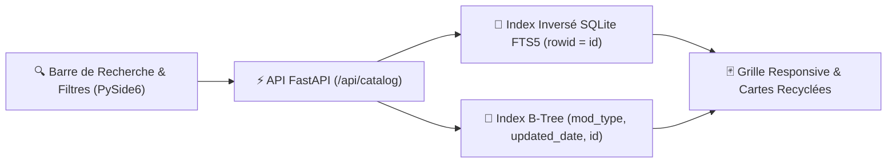

# ✨ Guide Complet des Fonctionnalités — SIMS 4 Mods Manager

Ce document présente en détail l'ensemble des fonctionnalités de **SIMS 4 Mods Manager**, de l'exploration unifiée des **22 plateformes** jusqu'au diagnostic binaire des conflits `.package` (`DBPF`).

---

## 1. 🌐 Catalogue Unifié Multi-Plateformes & Recherche Temps Réel (`FTS5`)

L'onglet **Catalogue Unifié** agrège en une seule interface fluide les mods issus de **22 plateformes** :
- **5 Portails Officiels de Frameworks** (`Deaderpool`, `Scumbumbo`, `Lumpinou`, `Wicked.cc`, `Basemental`).
- **12 Catalogues Communautaires & Créateurs SFW** (`CurseForge`, `The Sims Resource`, `ModTheSims`, `Nexus Mods`, `Patreon`, `SimsFinds`, `Maxis Match CC World`, `SimFileShare`, `Sims 4 Studio`, `GameBanana`, `The Sims Catalog`, `itch.io`, `LittleMsSam`, `SixamCC`).
- **5 Portails Adultes (`+18`)** (`LoversLab`, `NSFWMods`, `Synthira.ru`, `F95zone`, `SmutBase`), **masqués par défaut** et activables à la demande dans les Paramètres.

### Points clés du Catalogue :
- **Recherche Plein Texte Instantanée (`SQLite FTS5`)** : Recherche simultanée dans le titre, l'auteur, les tags et la description en quelques millisecondes.
- **Classification Automatique par Type (`mod_type` indexé)** : Filtrez en un clic par *Animations & Poses*, *Vêtements & Tenues*, *Coiffures*, *Peaux & Presets*, *Accessoires & Maquillage*, *Gameplay & Scripts*, *Objets & Terrains* ou *Traductions* en $O(\log N)$.
- **Filtres Croisés** : Filtrage par source, statut d'installation (*Installé*, *Non installé*, *Mise à jour disponible*) et niveau d'accès (*Accès Direct*, *Compte Requis*, *Abonnement Patreon*).
- **Tiroir Latéral de Synchronisation (`ProviderDrawer`)** : Visualisez la progression de scraping en temps réel (pages, articles, barre de progression) et mettez en pause ou relancez individuellement chaque plateforme.

---

## 2. 🛡️ Priorité Absolue aux Sites Officiels des Frameworks

Dans l'écosystème **Les Sims 4**, de nombreux créateurs référencent leurs prérequis via des liens tiers (ex. une fiche *LoversLab*, *CurseForge* ou *Patreon* pointant vers *MC Command Center* ou *XML Injector*).

**SIMS 4 Mods Manager** intercepte automatiquement ces dépendances en **$O(1)$** via [`dependency_special_cases.py`](../src/application/dependencies/dependency_special_cases.py) pour **toujours les télécharger depuis le site officiel public du créateur**, sans nécessiter de compte tiers :

| Framework / Mod Majeur | Créateur | Redirection Officielle Automatique | Compte Requis |
| :--- | :--- | :--- | :--- |
| **MC Command Center (MCCC) & MC WooHoo** | Deaderpool | `https://deaderpool-mccc.com` (`deaderpool`) | ❌ Non (100% Public) |
| **XML Injector & Teleport Any Sim** | Scumbumbo | `https://scumbumbomods.com` (`scumbumbo`) | ❌ Non (100% Public) |
| **RPO (WooHoo Wellness), Mood Pack, Toolbox, LGBTQIA+** | Lumpinou | `https://www.lumpinoumods.com` (`lumpinou`) | ❌ Non (100% Public) |
| **WickedWhims & WonderfulWhims** | TURBODRIVER | `https://wicked.cc` / `https://wonderfulwhims.com` (`wickedcc`) | ❌ Non (100% Public) |
| **Basemental Drugs, Gangs & Universal Venue List** | Basemental | `https://basementalcc.com` (`basemental`) | ❌ Non (100% Public) |
| **Andrew's Pose Player** | Andrew | `https://sims4studio.com/thread/2617/andrews-studio` (`sims4studio`) | ❌ Non (Direct SFS) |

---

## 3. 🧩 Résolution de Dépendances en Cascade, Déduplication & Filtrage du Bruit

Lors de l'inspection ou de l'installation d'un mod (ou d'une sélection multiple de mods) :

1. **Déduplication Inter-Plateformes (`ModMatcher` + `title_fingerprint`)** :
   - Si un mod requis a déjà été installé depuis une autre plateforme (ex. *XML Injector* installé depuis `scumbumbo` alors qu'un mod CurseForge le demande), l'empreinte canonique `title_fingerprint` le reconnaît immédiatement comme **`INSTALLED`** en $O(\log N)$ sans le re-télécharger.
2. **Mutualisation des Téléchargements Concurrents (`ActiveInstallationRegistry`)** :
   - Si vous lancez l'installation simultanée de 5 mods partageant tous une même dépendance (*Lumpinou's Toolbox* ou *WickedWhims*), la dépendance n'est téléchargée et extraite **qu'une seule fois**.
3. **Séparation Intelligente `MOD` vs `COMMENT_NOISE`** :
   - Les consignes d'installation laissées par les auteurs dans leurs sections "Requirements" (*"Enable Script Mods in Game Options"*, *"Do not reupload"*, *"Extract in your Mods folder"*) sont automatiquement filtrées en **`COMMENT_NOISE`**.
   - **Surcharge Manuelle Bidirectionnelle** : Un bouton sur chaque ligne permet à l'utilisateur de reclasser à tout moment un élément de *Mod Requis* vers *Note / Commentaire* (et inversement), avec mémorisation persistante dans SQLite.

---

## 4. 📢 Signalement & Interpellation des Créateurs (Commentaires & MP)

Lorsqu'un mod mentionne des prérequis ambigus ou un lien cassé :
- **Vérification d'Authentification Préalable** : L'application vérifie si une session active existe pour la plateforme cible (`SessionManager.is_member_authenticated`) et invite l'utilisateur à se connecter si nécessaire.
- **Anti-Doublon Automatique** : Avant tout envoi, l'application inspecte les commentaires existants de la fiche pour éviter tout message en double.
- **Message Standardisé en Anglais & Révocation** : Génère un message courtois et structuré listant les dépendances non résolues, le publie en commentaire public ou en message privé (MP), et permet de le supprimer directement depuis l'interface.

---

## 5. 📦 Installation Sécurisée, Règle `.ts4script` & Rollback de Mise à Jour

Le moteur d'exécution des **Sims 4** impose une contrainte stricte : **les fichiers `.ts4script` ne sont chargés par le jeu que s'ils se trouvent à la racine de `Mods/` ou à 1 seul sous-dossier de profondeur (`Mods/<NomDuMod>/script.ts4script`)**.

- **Aplatissement Automatique `.ts4script` (Profondeur $\le 1$)** : Lors de l'extraction d'une archive `.zip`, `.7z` ou `.rar`, tout fichier `.ts4script` niché dans des sous-dossiers profonds est automatiquement remonté dans `Mods/<NomDuMod>/`, tandis que les fichiers `.package` conservent leur structure jusqu'à 5 niveaux.
- **Activation / Désactivation Réversible (`.disabled`)** : Activez ou désactivez n'importe quel mod en un clic (renommage atomique `.package` $\leftrightarrow$ `.package.disabled` et mise à jour SQL directe).
- **Sauvegarde ZIP & Restauration en 1 Clic** : Avant chaque mise à jour d'un mod, une archive de sauvegarde est créée dans `.sims4_mod_manager/backups/`. En cas d'incompatibilité avec votre partie, le bouton **Restaurer la version précédente** rétablit instantanément la version antérieure.
- **Protection de vos Fichiers de Configuration** : Les fichiers de réglages utilisateur (`mc_settings.cfg`, `.ini`, `.json`, `.log`) sont préservés lors des mises à jour.

---

## 6. ⚔️ Détecteur de Conflits Binaires DBPF (`mmap` Zero-Copy)

L'outil de diagnostic inspecte l'ensemble des fichiers `.package` actifs de votre dossier `Mods` :
- **Lecture Binaire `mmap` Sans Copie RAM** : Analyse l'en-tête `DBPF` et la table d'index binaire pour extraire les triplets **`TGI` (`Type-Group-Instance`)** de chaque ressource.
- **Cache SQLite Persistant (`DbpfPackageCache`)** : Indexé par `(file_path, mtime, file_size)` avec upsert natif `ON CONFLICT DO UPDATE` et purge automatique des fichiers supprimés. Seuls les fichiers `.package` modifiés depuis le dernier scan sont ré-analysés.
- **Distinction Conflits Critiques vs Traductions (`STBL`)** : Sépare clairement les collisions de gameplay (`Tuning`, `SimData`, `ObjectCatalog`) des remplacements légitimes de tables de traduction (`STBL 0x220557DA`), et permet de désactiver le package en conflit directement depuis le rapport.

---

## 7. 🌍 Internationalisation (5 Langues) & Sécurité

- **5 Langues Intégrées avec Changement à Chaud** : Français (`fr`), Anglais (`en`), Espagnol (`es`), Chinois simplifié (`zh`) et Hindi (`hi`) avec parité complète des clés.
- **Chiffrement `AES-256-GCM` au Repos** : Tous les cookies de session et jetons API (`AccountSession`) sont chiffrés localement.
- **Bouclier Anti-SSRF & Anti-Zip-Bomb** : Validation stricte des domaines et IPs avant téléchargement, contrôle des ratios de compression et blocage des exécutables malveillants (`.exe`, `.bat`, `.ps1`, `.dll`) dans les archives de mods.
