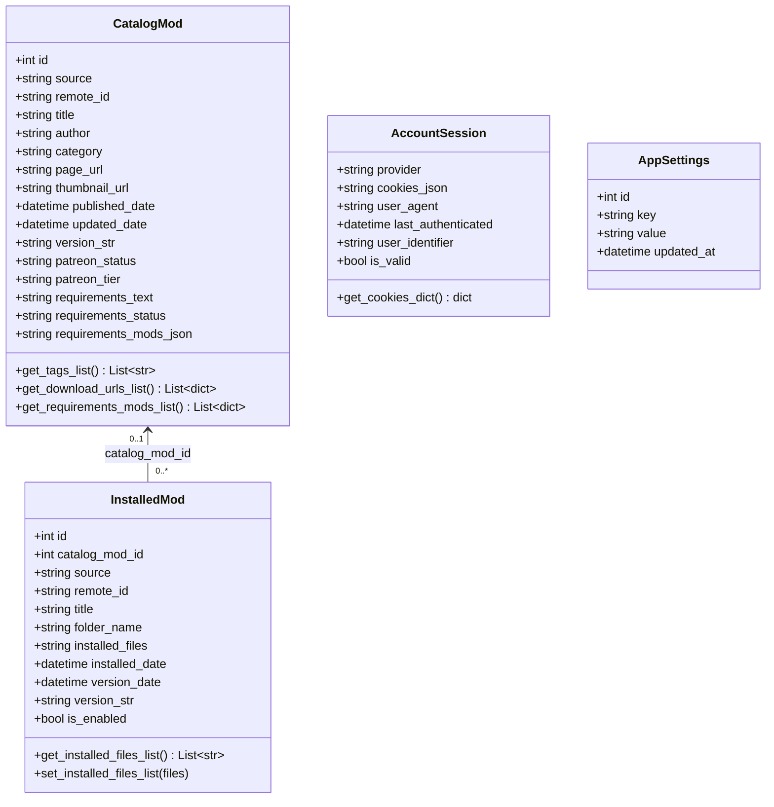
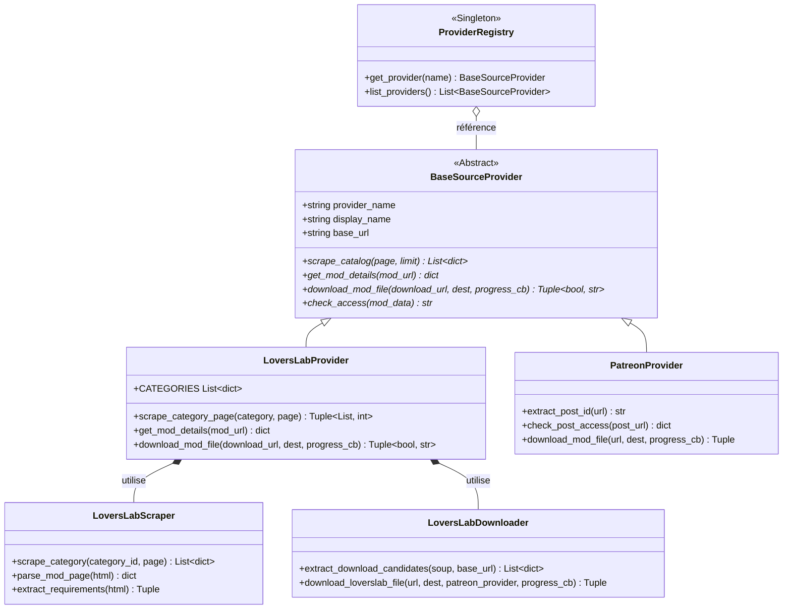
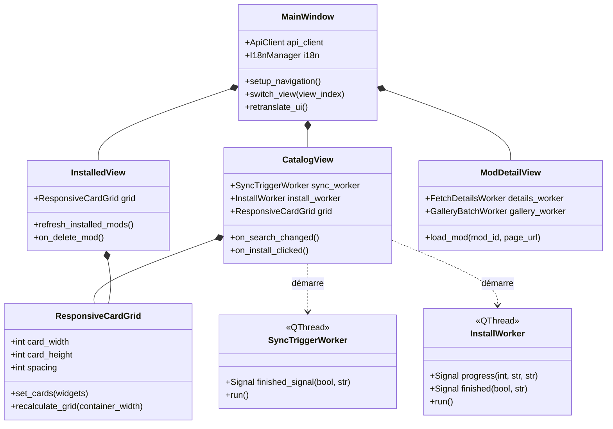
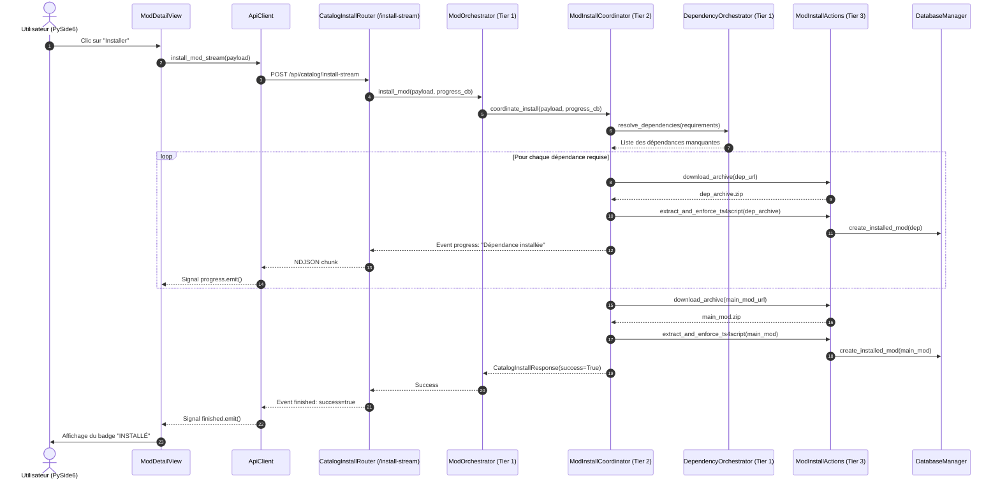

# Schémas de Liaisons et Diagrammes de Classes

Ce document détaille les relations, contrats d'interface et flux d'interaction entre les différentes classes et modules de **SIMS 4 Mods Manager**, structurés selon l'architecture **POO 3-Tiers**.

---

## 📊 1. Modèle de Données (ORM SQLAlchemy)

---

## ⚙️ 2. Architecture 3-Tiers POO (`src/application/`)

```mermaid
classDiagram
    %% Tier 1 : Orchestrators
    class CatalogOrchestrator {
        +sync_catalog(max_pages, categories)
        +get_sync_status() CatalogSyncStatusResponse
        +check_dependencies(title, page_url, source)
    }

    class ModOrchestrator {
        +install_mod(payload, progress_cb) CatalogInstallResponse
        +update_mod(installed_id) Tuple~bool, str~
        +update_all_mods() Tuple~int, int~
        +toggle_mod(installed_id, state) Tuple~bool, str~
        +scan_and_sync_installed_mods()
    }

    class DependencyOrchestrator {
        +resolve_dependencies(reqs, session) List~DependencyItem~
        +generate_report(mod_title, page_url) str
    }

    %% Tier 2 : Coordinators
    class CatalogSyncCoordinator {
        +SyncTracker tracker
        +execute_sync(max_pages, categories)
    }

    class ModInstallCoordinator {
        +coordinate_install(payload, progress_cb) CatalogInstallResponse
    }

    class ModUpdateCoordinator {
        +coordinate_update(installed_id) Tuple~bool, str~
        +coordinate_batch_update(ids) Tuple~int, int~
    }

    class ModToggleCoordinator {
        +coordinate_toggle(installed_id, state) Tuple~bool, str~
    }

    class DependencyResolutionCoordinator {
        +coordinate_resolution(requirements) List~DependencyItem~
    }

    %% Tier 3 : Actions
    class CatalogSyncActions {
        +persist_catalog_mod(mod_data, session)
        +normalize_dates(raw_date) datetime
    }

    class ModInstallActions {
        +download_archive(url, dest, progress_cb)
        +extract_and_enforce_ts4script(archive_path, dest_dir)
        +validate_dbpf_headers(folder_path) bool
    }

    class ModUpdateActions {
        +create_rollback_backup(folder_path) Path
        +restore_backup_on_failure(backup_zip, target_folder)
    }

    class ModToggleActions {
        +apply_disabled_extension(folder_path)
        +remove_disabled_extension(folder_path)
    }

    class DependencyResolutionActions {
        +find_mod_in_catalog_or_disk(name) Optional~CatalogMod~
        +classify_requirement_status(mod_entity) RequirementStatus
    }

    %% Liaisons Tier 1 -> Tier 2
    CatalogOrchestrator --> CatalogSyncCoordinator
    ModOrchestrator --> ModInstallCoordinator
    ModOrchestrator --> ModUpdateCoordinator
    ModOrchestrator --> ModToggleCoordinator
    DependencyOrchestrator --> DependencyResolutionCoordinator

    %% Liaisons Tier 2 -> Tier 3
    CatalogSyncCoordinator --> CatalogSyncActions
    ModInstallCoordinator --> ModInstallActions
    ModUpdateCoordinator --> ModUpdateActions
    ModToggleCoordinator --> ModToggleActions
    DependencyResolutionCoordinator --> DependencyResolutionActions
```

---

## 🔌 3. Couche Fournisseurs Externes (Providers)

---

## 🖥️ 4. Interface Graphique PySide6 & Workers Asynchrones

---

## 🔄 5. Séquence d'Installation 3-Tiers avec Dépendances

