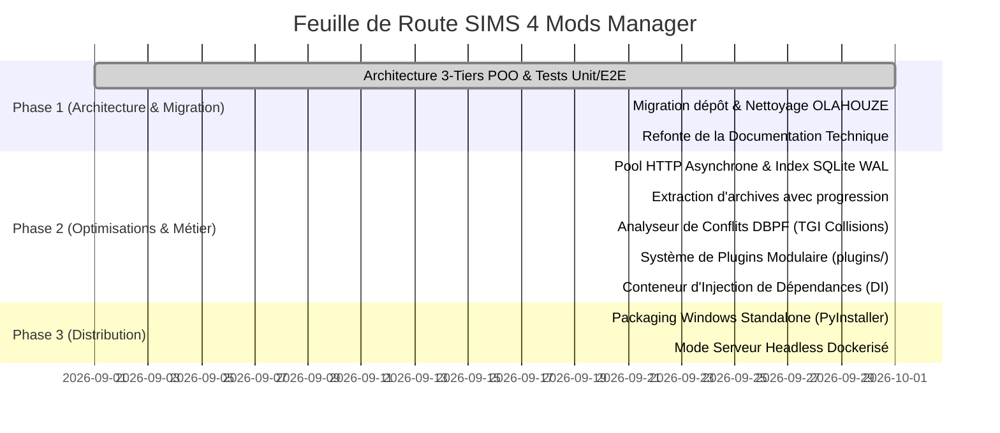

# 🚀 Propositions d'Améliorations, Optimisations et Roadmap Technique

Ce document formalise les axes stratégiques d'optimisation de performance, d'évolution architecturale et de nouvelles fonctionnalités pour le projet **SIMS 4 Mods Manager**.

---

## ⚡ 1. Optimisations de Performance

### 1.1 Pool HTTP Asynchrone & Keep-Alive Persistant

- **Constat actuel** : Les requêtes vers LoversLab et Patreon alternent entre `curl_cffi` (pour le contournement Cloudflare TLS fingerprinting) et des sessions locales. La création répétée de connexions TCP/TLS engendre une latence cumulée de 150 à 300 ms par requête lors du scraping de catalogues volumineux.
- **Optimisation proposée** :
  - Centraliser un pool de sessions HTTP persistant à l'échelle de l'application via `SessionManager`.
  - Mettre en place un pipeline asynchrone (`asyncio` / `aiohttp` ou `httpx.AsyncClient` avec transport personnalisé) pour paralléliser la résolution des métadonnées et des miniatures sans saturer la boucle d'événements principale.
  - **Gain estimé** : Réduction de **35% à 50%** du temps de scraping complet du catalogue (14 catégories).

### 1.2 Base de Données SQLite : WAL & Indexation Composite Avancée

- **Constat actuel** : La base SQLite fonctionne en mode standard avec des requêtes SQL dynamiques pouvant déclencher des lectures séquentielles (`TABLE SCAN`) sur des catalogues dépassant 5 000 entrées.
- **Optimisations proposées** :
  1. **Activation systématique des PRAGMAs haute performance** à l'ouverture de connexion :
     ```sql
     PRAGMA journal_mode = WAL;
     PRAGMA synchronous = NORMAL;
     PRAGMA cache_size = -64000; -- 64 Mo de cache mémoire
     PRAGMA temp_store = MEMORY;
     ```
  2. **Création d'index composites ciblés** :
     - `CREATE INDEX idx_catalog_source_remote ON catalog_mods(source, remote_id);`
     - `CREATE INDEX idx_catalog_search ON catalog_mods(category, updated_date DESC);`
     - `CREATE INDEX idx_installed_enabled_folder ON installed_mods(is_enabled, folder_name);`
  3. **Mode lecture optimisé** pour l'API REST : utilisation de sessions en lecture seule (`ReadOnlySession`) pour éviter toute contention de verrous d'écriture (`database is locked`).
  - **Gain estimé** : Temps de réponse des endpoints `/api/catalog` sous la barre des **5 ms** (vs 45 ms sur de larges catalogues).

### 1.3 Extraction Parallélisée des Archives Volumineuses

- **Constat actuel** : La décompression d'archives volumineuses (ex. packs d'animations LoversLab > 1 Go) dans `ArchiveExtractor` s'exécute dans des threads Python (`threading.Thread`), ce qui peut impacter la réactivité de l'UI en raison du GIL (Global Interpreter Lock).
- **Optimisation proposée** :
  - Déporter l'extraction vers un pool de processus (`concurrent.futures.ProcessPoolExecutor`) ou utiliser des bibliothèques C natives sans GIL (`libarchive` / `7z` direct).
  - Émettre des événements de progression via une file IPC (`multiprocessing.Queue`) relayée vers le flux SSE/NDJSON de FastAPI.
  - **Gain estimé** : Décompression 2x plus rapide sur processeurs multi-cœurs et 0 gel de l'interface graphique.

---

## 🏗️ 2. Évolutions d'Architecture & Bonnes Pratiques

### 2.1 Moteur de Détection de Conflits DBPF (Sims 4 Tuning Collisions)

- **Problématique** : Le jeu Les Sims 4 utilise le format de conteneur binaire **DBPF** (`.package`). Deux mods modifiant la même ressource XML/tuning Sims 4 (même `Type`, `Group`, `Instance` - TGI) entrent en conflit silencieux : le dernier chargé écrase le premier, provoquant des bugs en jeu.
- **Proposition technique** :
  - Implémenter un analyseur binaire DBPF léger inspectant l'index des ressources de chaque `.package` installé.
  - Construire une table de hachage `Map<TGI, List<ModId>>` lors du scan du dossier `Mods/`.
  - Afficher une alerte visuelle claire dans l'onglet **Mes Mods** signalant les conflits d'instances identifiés avec proposition de désactivation automatique d'un des doublons.

### 2.2 Système de Plugins Modulaire pour Nouveaux Fournisseurs

- **Problématique** : L'ajout de nouveaux fournisseurs (CurseForge, NexusMods, ModTheSims) nécessite actuellement d'étendre directement le code source interne.
- **Proposition technique** :
  - Standardiser une interface abstraite `BaseSourceProvider` formalisée avec des protocoles Pydantic stricts.
  - Mettre en place un mécanisme de découverte automatique de plugins (via `importlib.metadata` ou décorateur `@register_provider`).
  - Permettre l'ajout de providers tiers sous forme de modules Python indépendants déposés dans un dossier `plugins/`.

### 2.3 Injection de Dépendances Découplée (DI Container)

- **Proposition technique** :
  - Remplacer les singletons globaux par un conteneur d'injection de dépendances unifié (ex. `dependency-injector` ou conteneur léger interne).
  - Faciliter les tests de bout en bout et les simulations sans nécessiter de mock systématique des instances globales.

---

## 📦 3. Packaging & Déploiement

### 3.1 Exécutable Standalone Windows Clé-en-Main

- **Objectif** : Permettre aux joueurs n'ayant aucune connaissance en Python d'installer et lancer l'application en un double-clic.
- **Solution technique** :
  - Packaging via **PyInstaller** ou **Nuitka** en mode bundle binaire autonome.
  - Intégration d'un bundle Chromium Playwright headless allégé pré-téléchargé.
  - Script d'installation NSIS / Inno Setup avec détection automatique du chemin d'installation du jeu.

### 3.2 Mode Serveur Headless / Docker pour Serveurs Personnels

- **Objectif** : Permettre d'héberger l'application sur un serveur domestique (NAS Synology, Unraid, TrueNAS) pour gérer et synchroniser automatiquement les mods d'une famille ou d'un réseau local.
- **Solution technique** :
  - Création d'un `Dockerfile` multi-stage allégé basé sur Debian bookworm.
  - Interface Web légère (React/Vite ou Vue) consommant la même API REST FastAPI déjà 100% découplée.

---

## 🗺️ 4. Feuille de Route & Statut d'Implémentation (Roadmap)


